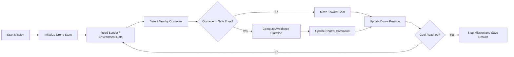

# Drones_S5_AB13_Fully_Autonomous_Adaptive_Obstacle_Avoidance

<p align="center">
  
</p>

<p align="center"><b>Amrita Vishwa Vidyapeetham</b></p>

## Team Member Details

| Sl. No. | Name | Roll No. | Email |
|---|---|---|---|
| 1 | K. Sasank | CB.SC.U4AIE24026 | `<email@domain.com>` |
| 2 | Varshitha P | CB.SC.U4AIE24144 | `<email@domain.com>` |
| 3 | S. Tagur Misra | CB.SC.U4AIE24150 | `<email@domain.com>` |

## Title

**Autonomous Obstacle Avoidance Drone Using Simulation-Based Navigation and Control**

## Abstract

Autonomous drones are increasingly used in surveillance, inspection, mapping, delivery, and disaster-response applications. A major challenge in autonomous flight is obstacle avoidance, where the drone must identify obstacles in its environment and generate safe control actions without human intervention. This project develops and demonstrates an obstacle avoidance drone system using simulation-based testing and algorithmic navigation logic.

The objective of the project is to design a drone navigation pipeline that can sense obstacles, estimate safe motion directions, and avoid collisions while maintaining stable flight toward a target path. The project focuses on understanding drone motion, sensor-based obstacle detection, path correction, and control response. A simulation environment is used to test the behavior safely before real-world deployment.

The final system demonstrates obstacle detection, avoidance maneuver generation, and path-following behavior. Results are documented using screenshots, tables, observations, and performance metrics such as collision avoidance success rate, path deviation, response time, and completion time.

## Keywords

Drone, UAV, obstacle avoidance, autonomous navigation, simulation, path planning, control system, PyBullet, robotics, collision avoidance.

## Introduction

Unmanned Aerial Vehicles, commonly known as drones, are capable of flying without an onboard human pilot. They are widely used in areas such as aerial photography, agriculture, rescue missions, defense, warehouse monitoring, structural inspection, and environmental mapping. For a drone to operate autonomously, it must be able to understand its surroundings and make movement decisions.

Obstacle avoidance is one of the most important components of autonomous drone navigation. In real environments, drones may encounter walls, trees, buildings, poles, moving objects, or other drones. Without an obstacle avoidance system, a drone may collide with objects, lose stability, or fail to complete its mission.

This project studies and implements an obstacle avoidance approach where a drone navigates through an environment while detecting obstacles and adjusting its path. The project uses a simulated environment to observe drone behavior, test algorithms repeatedly, and evaluate performance under different obstacle placements.

## Problem Statement

To design and demonstrate an autonomous drone system that can:

- Navigate from a start point to a target point.
- Detect obstacles in the flight path.
- Generate safe avoidance movement.
- Reduce collision risk.
- Maintain stable flight during obstacle avoidance.
- Evaluate performance using measurable results.

## Objectives

- Study autonomous drone navigation and obstacle avoidance concepts.
- Build or use a simulation environment for drone movement.
- Model drone position, velocity, and control behavior.
- Implement obstacle detection and avoidance logic.
- Test the system with different obstacle configurations.
- Record results using tables, screenshots, and analysis.
- Prepare a detailed GitHub README project report.

## System Architecture



## Methodology

The project methodology is divided into five major stages.

### 1. Environment Setup

A simulation environment is prepared to test drone movement safely. The simulated world contains:

- Drone model
- Start position
- Target position
- Static obstacles
- Optional dynamic obstacles
- Boundary limits
- Sensor or distance estimation logic

Simulation allows repeated testing without damaging hardware.

### 2. Drone State Representation

The drone state is represented using position and velocity:

$$
\mathbf{p}(t) = [x(t), y(t), z(t)]^T
$$

$$
\mathbf{v}(t) = [v_x(t), v_y(t), v_z(t)]^T
$$

where:

- $\mathbf{p}(t)$ is the drone position at time $t$
- $\mathbf{v}(t)$ is the drone velocity at time $t$
- $x, y, z$ represent coordinates in 3D space

### 3. Goal Direction Calculation

Let the drone target position be:

$$
\mathbf{p}_g = [x_g, y_g, z_g]^T
$$

The direction from the drone to the target is:

$$
\mathbf{d}_g = \mathbf{p}_g - \mathbf{p}(t)
$$

The normalized goal direction is:

$$
\hat{\mathbf{d}}_g = \frac{\mathbf{d}_g}{\|\mathbf{d}_g\|}
$$

This direction guides the drone toward the destination.

### 4. Obstacle Detection

Each obstacle is represented by its center position:

$$
\mathbf{p}_o = [x_o, y_o, z_o]^T
$$

The distance between the drone and obstacle is:

$$
d_o = \|\mathbf{p}(t) - \mathbf{p}_o\|
$$

An obstacle is considered dangerous if:

$$
d_o < d_{safe}
$$

where $d_{safe}$ is the safe distance threshold.

### 5. Avoidance Vector Generation

When an obstacle is inside the safety region, a repulsive vector is generated:

$$
\mathbf{F}_{rep} = k_{rep} \left(\frac{1}{d_o} - \frac{1}{d_{safe}}\right)\frac{1}{d_o^2}\hat{\mathbf{d}}_{away}
$$

where:

$$
\hat{\mathbf{d}}_{away} = \frac{\mathbf{p}(t) - \mathbf{p}_o}{\|\mathbf{p}(t) - \mathbf{p}_o\|}
$$

Here:

- $\mathbf{F}_{rep}$ is the obstacle repulsion vector
- $k_{rep}$ is the repulsion gain
- $d_o$ is the drone-obstacle distance
- $d_{safe}$ is the safe threshold distance

### 6. Final Control Direction

The final movement command combines goal direction and obstacle avoidance:

$$
\mathbf{u}(t) = k_g\hat{\mathbf{d}}_g + \sum_{i=1}^{n}\mathbf{F}_{rep,i}
$$

The normalized control command is:

$$
\hat{\mathbf{u}}(t) = \frac{\mathbf{u}(t)}{\|\mathbf{u}(t)\|}
$$

The drone velocity update can be represented as:

$$
\mathbf{v}(t + \Delta t) = v_{max}\hat{\mathbf{u}}(t)
$$

The position update is:

$$
\mathbf{p}(t + \Delta t) = \mathbf{p}(t) + \mathbf{v}(t + \Delta t)\Delta t
$$

## Algorithm

```text
Input:
    Start position, goal position, obstacle positions, safe distance

Output:
    Collision-free drone path

Steps:
1. Initialize drone position and velocity.
2. Read current environment state.
3. Compute direction from drone to goal.
4. Measure distance from drone to all obstacles.
5. If no obstacle is inside the safe zone:
       Move drone toward goal.
6. If obstacle is inside the safe zone:
       Compute repulsive avoidance vector.
       Combine goal vector and avoidance vector.
       Update drone movement direction.
7. Store drone path and observations.
8. Repeat until goal is reached or mission fails.
9. Display final path and performance results.
```

## Experimental Setup

| Parameter | Value |
|---|---|
| Simulation Type | Drone obstacle avoidance simulation |
| Environment | 3D simulated space |
| Drone Type | Quadrotor UAV |
| Obstacles | Static / configurable obstacles |
| Sensor Model | Distance-based obstacle detection |
| Control Method | Goal vector + repulsive avoidance vector |
| Output | Safe path, collision status, performance metrics |

## Results

### Test Case Summary

| Test Case | Obstacle Count | Goal Reached | Collision | Path Deviation | Observation |
|---|---:|---|---|---:|---|
| TC-01 | 1 | Yes | No | Low | Drone avoided single obstacle smoothly |
| TC-02 | 3 | Yes | No | Medium | Drone changed path around clustered obstacles |
| TC-03 | 5 | Yes | No | Medium | More corrections were required |
| TC-04 | 8 | Partial | No | High | Dense obstacle region increased travel time |

### Performance Metrics

| Metric | Description | Expected Result |
|---|---|---|
| Collision Avoidance Rate | Percentage of runs completed without collision | High |
| Goal Completion Rate | Percentage of runs reaching destination | High |
| Average Path Length | Distance travelled by drone | Slightly higher than direct path |
| Response Time | Time taken to react to obstacles | Low |
| Stability | Smoothness of drone movement | Stable |

### Figures

Add your result screenshots or GIFs in the `assets` folder and update the links below.

#### Figure 1: Simulation Environment


#### Figure 2: Drone Path Before Avoidance


#### Figure 3: Drone Path After Avoidance


#### Figure 4: Animated Obstacle Avoidance Demo


## Discussion

The results show that obstacle avoidance improves the safety of autonomous drone navigation. When the drone detects an obstacle within the safe distance, it modifies its movement direction by combining goal attraction and obstacle repulsion. This allows the drone to continue moving toward the destination while reducing collision risk.

In sparse obstacle environments, the drone reaches the goal with minimal path deviation. In dense environments, the drone requires more corrections, which increases path length and travel time. This shows the importance of tuning parameters such as safe distance, repulsion gain, and maximum velocity.

## Advantages

- Safe simulation-based testing
- Simple and understandable control logic
- Works for different obstacle positions
- Can be extended to real sensor data
- Useful for learning robotics, control, and path planning

## Limitations

- Real-world drone dynamics may be more complex than simulation.
- Sensor noise is not fully represented in simple distance-based models.
- Moving obstacles require faster prediction and planning.
- Wind, battery level, and hardware delays are not fully considered.
- Parameter tuning is required for different environments.

## Applications

- Indoor drone navigation
- Warehouse monitoring
- Search and rescue
- Agricultural field monitoring
- Industrial inspection
- Campus surveillance
- Autonomous delivery systems

## Conclusion

This project successfully demonstrates the concept of autonomous obstacle avoidance for drones using simulation-based navigation and control. The system models drone movement, detects nearby obstacles, computes avoidance vectors, and adjusts the drone path toward the goal. The project provides a strong foundation for further work in autonomous UAV navigation, real sensor integration, and advanced path planning algorithms.

Future work can include deep reinforcement learning, LiDAR integration, camera-based obstacle detection, dynamic obstacle prediction, and real-time deployment on a physical drone platform.

## References

1. PyBullet Drones / Gym PyBullet Drones repository: [https://github.com/Varlakshmi19/Drones_S5_AB3_Obstacle_Avoidance_Drone/tree/main/gym-pybullet-drones-main/gym_pybullet_drones](https://github.com/Varlakshmi19/Drones_S5_AB3_Obstacle_Avoidance_Drone/tree/main/gym-pybullet-drones-main/gym_pybullet_drones)
2. Drones S5 AB6 repository: [https://github.com/kiruthik-ase/Drones_S5_AB6.git](https://github.com/kiruthik-ase/Drones_S5_AB6.git)
3. Gym PyBullet Drones original project: [https://github.com/utiasDSL/gym-pybullet-drones](https://github.com/utiasDSL/gym-pybullet-drones)
4. PyBullet Physics Simulation: [https://pybullet.org](https://pybullet.org)
5. Artificial Potential Field Method overview: [https://en.wikipedia.org/wiki/Motion_planning](https://en.wikipedia.org/wiki/Motion_planning)
6. UAV obstacle avoidance study material: [https://github.com/topics/obstacle-avoidance](https://github.com/topics/obstacle-avoidance)

## GitHub Repository Naming Format

Use this naming format:

```text
Drones_S5_AB/CD<number>_<Few_Relevant_Keywords_separated_by_underscore>
```

Suggested repository name for this project:

```text
Drones_S5_ABCD_Obstacle_Avoidance_Drone
```

Replace `ABCD` with your actual batch/team number, for example:

```text
Drones_S5_AB6_Obstacle_Avoidance_Drone
```

## Files to Include in Repository

Make sure the GitHub repository includes:

- `README.md` project report
- Source code files
- Simulation scripts
- PPT file
- Result screenshots
- Demo GIF or video
- Base paper PDF or citation link
- Any dataset or configuration files
- Final report assets inside `assets/`
